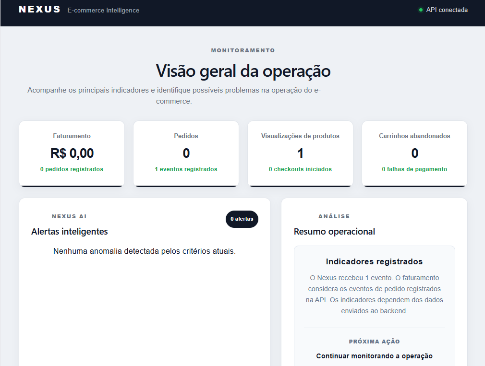
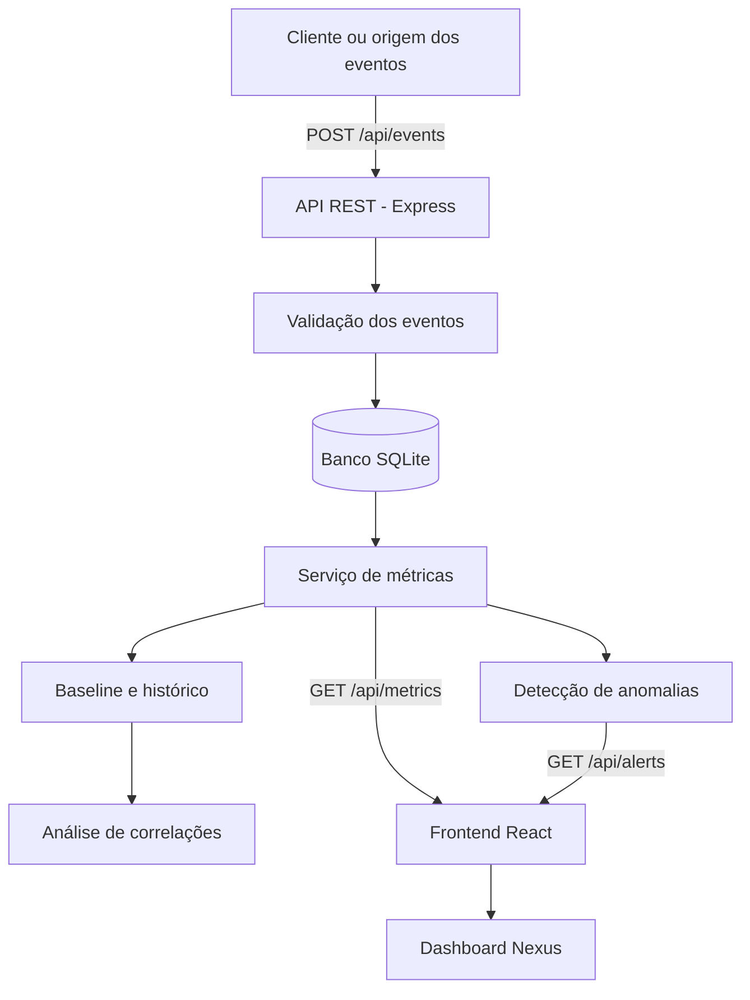

# Nexus — Inteligência Operacional para E-commerce

Plataforma full-stack para monitoramento de operações de e-commerce, coleta de eventos, análise de indicadores e identificação de possíveis anomalias operacionais.

O Nexus transforma eventos da operação em métricas e alertas que ajudam a identificar situações que merecem investigação, apoiando a tomada de decisão.

**Status:** Em desenvolvimento.

## Dashboard

Interface de monitoramento operacional do Nexus, integrada à API REST e exibindo indicadores calculados a partir dos eventos registrados.



## Visão geral

O sistema recebe eventos relacionados à operação de um e-commerce, armazena os registros e calcula indicadores como visualizações de produtos, checkouts iniciados, pedidos, falhas de pagamento, carrinhos abandonados e faturamento.

A partir desses dados, o backend executa regras de detecção de anomalias, calcula referências históricas e identifica possíveis correlações entre indicadores.

## Funcionalidades implementadas

### Dashboard

- Exibição de faturamento total registrado.
- Acompanhamento da quantidade de pedidos.
- Monitoramento de visualizações de produtos.
- Acompanhamento de carrinhos abandonados.
- Exibição de alertas operacionais.
- Consumo dos dados disponibilizados pela API REST.

### Backend e inteligência operacional

- Recebimento e validação de eventos.
- Persistência de eventos em banco de dados SQLite.
- Cálculo automático dos principais indicadores.
- Detecção de taxas elevadas de abandono de carrinho.
- Detecção de taxas elevadas de falhas de pagamento.
- Registro periódico de snapshots históricos.
- Cálculo de baseline a partir do histórico disponível.
- Identificação de possíveis correlações entre indicadores.
- Validação de dados recebidos pela API.
- Restrição de origem por configuração CORS.
- Limite de 100 KB para corpos de requisições JSON.

## Arquitetura

O projeto está organizado em duas aplicações principais:



### Estrutura de diretórios

```text
nexus/
├── backend/
│   ├── src/
│   │   ├── services/
│   │   ├── simulator/
│   │   ├── store/
│   │   ├── types/
│   │   ├── app.ts
│   │   └── server.ts
│   └── package.json
│
├── frontend/
│   ├── src/
│   │   ├── components/
│   │   ├── data/
│   │   ├── App.tsx
│   │   └── App.css
│   └── package.json
│
├── docs/
└── README.md
```

## Tecnologias utilizadas

| Camada | Tecnologias |
|---|---|
| Frontend | React 19, TypeScript, Vite |
| Backend | Node.js, TypeScript, Express 5 |
| Banco de dados | SQLite, better-sqlite3 |
| Comunicação | API REST, JSON |
| Testes | Vitest |
| Qualidade de código | ESLint |
| Versionamento | Git e GitHub |

## Indicadores monitorados

O Nexus trabalha com os seguintes tipos de eventos:

| Evento | Descrição |
|---|---|
| `product_viewed` | Visualização de produto |
| `checkout_started` | Início do checkout |
| `order_created` | Criação de pedido |
| `payment_failed` | Falha no pagamento |
| `cart_abandoned` | Abandono de carrinho |

O faturamento é calculado a partir dos valores dos eventos de criação de pedidos.

## API REST

| Método | Endpoint | Descrição |
|---|---|---|
| GET | `/api/health` | Verifica o funcionamento da API |
| POST | `/api/events` | Registra um evento |
| GET | `/api/events` | Lista os eventos registrados |
| GET | `/api/metrics` | Retorna os indicadores calculados |
| GET | `/api/metrics/history` | Consulta o histórico de indicadores |
| GET | `/api/alerts` | Retorna os alertas detectados |
| GET | `/api/baseline` | Retorna a comparação com a referência histórica |
| GET | `/api/correlations` | Retorna possíveis correlações entre indicadores |

### Exemplo de registro de evento

Requisição:

```http
POST /api/events
Content-Type: application/json
```

Corpo:

```json
{
  "type": "order_created",
  "customerId": "cliente-001",
  "orderId": "pedido-001",
  "value": 199.90
}
```

O campo `customerId` é obrigatório. Os campos exigidos adicionalmente dependem do tipo de evento. O campo `timestamp`, quando omitido, é preenchido pelo backend.

## Como executar localmente

### Pré-requisitos

- Node.js e npm instalados.
- Git instalado.

### 1. Clonar o repositório

```bash
git clone https://github.com/AlanGomes-Dev/nexus.git
cd nexus
```

### 2. Inicializar o backend

Em um terminal:

```bash
cd backend
npm install
npm run dev
```

A API ficará disponível em:

```text
http://localhost:3000
```

### 3. Inicializar o frontend

Abra outro terminal:

```bash
cd frontend
npm install
npm run dev
```

Acesse o endereço informado pelo Vite, normalmente:

```text
http://localhost:5173
```

O frontend utiliza `http://localhost:3000` como endereço padrão da API.

## Configurações

As seguintes variáveis de ambiente podem ser utilizadas:

| Variável | Finalidade | Padrão |
|---|---|---|
| `CORS_ORIGIN` | Origens permitidas para acessar a API | `http://localhost:5173` |
| `NEXUS_DB_PATH` | Caminho personalizado do banco SQLite | `backend/data/nexus.db` |
| `VITE_API_URL` | Endereço-base da API consumida pelo frontend | `http://localhost:3000` |

O backend aceita múltiplas origens em `CORS_ORIGIN`, separadas por vírgula.

## Testes e validação

### Backend

```bash
cd backend
npm run build
npm test
```

### Frontend

```bash
cd frontend
npm run build
npm run lint
```

Os testes automatizados do backend são executados com Vitest.

## Armazenamento de dados

O Nexus utiliza SQLite para persistir os eventos e o histórico de indicadores.

Por padrão, o banco é criado em:

```text
backend/data/nexus.db
```

É possível definir outro caminho por meio da variável `NEXUS_DB_PATH`.

Os snapshots históricos são registrados periodicamente enquanto o servidor está em execução.

## Próximas evoluções

O projeto está em desenvolvimento. Entre as possibilidades de evolução estão:

- Integração com plataformas reais de e-commerce.
- Expansão dos indicadores e das análises operacionais.
- Evolução da interface para visualização de histórico e correlações.
- Integração com modelos de inteligência artificial.
- Containerização e preparação para implantação em ambiente de produção.

## Autor

Desenvolvido por **Alan Gomes**.

[GitHub — AlanGomes-Dev](https://github.com/AlanGomes-Dev)

---

Projeto desenvolvido com foco em engenharia de software, arquitetura full-stack, análise de dados e inteligência operacional para e-commerce.